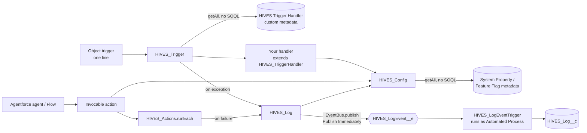
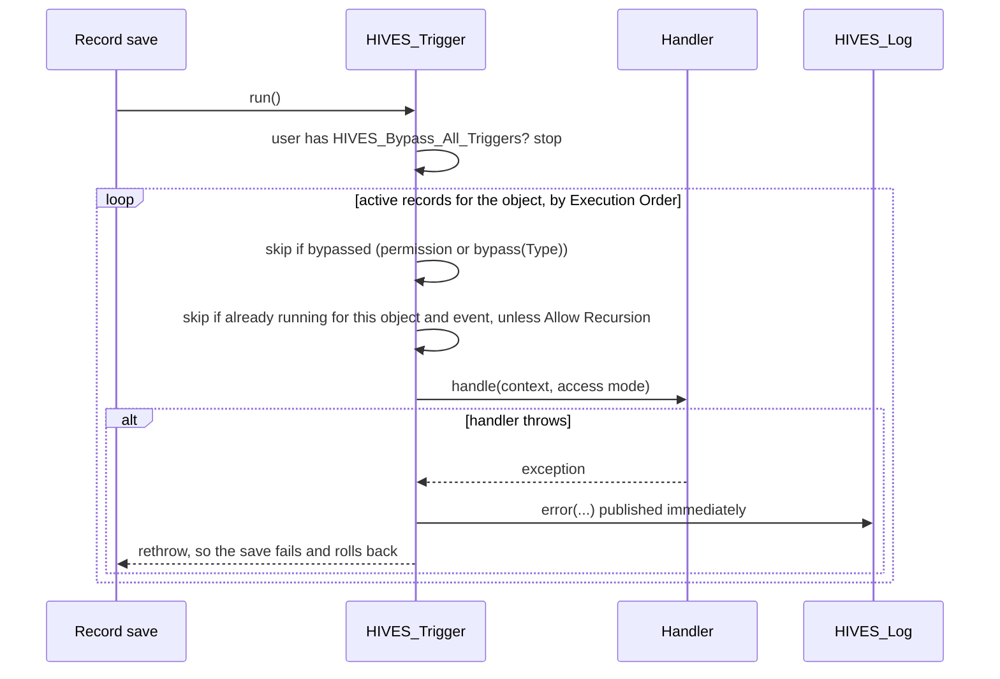

# HIVE-S design

This document explains how the pieces fit together and why they are built this way. For usage,
see the [README](../README.md).

## Pieces

## One trigger save

## Decisions

**Custom metadata, read with `getAll()`.** Handler records, settings and flags deploy with the code
and can be changed in production without a deploy. `getAll()` reads them from the metadata cache
without a query. The cost is that tests can't insert custom metadata. Each reader
has a `@TestVisible` override that `HIVES_TestData` fills.

**Bad configuration fails at deploy, not at save.** `HIVES_Trigger.configurationProblems()` checks
every handler record, active or not. A missing class, a class that doesn't extend the base, or an
unknown object is reported. `HIVES_ConfigurationCheckTest` asserts the list is empty, so a broken
record fails `RunLocalTests` during the deploy. In v1, the first user to save a record found out.

**Handler errors are logged, then rethrown.** Swallowing an exception in a trigger saves a
half-processed record. Rethrowing keeps the platform's all-or-nothing behavior. The log entry is
published immediately, so it survives that rollback.

**The recursion guard counts depth, not record ids.** v1 remembered processed record ids for the
whole transaction. That silently skipped partial-success retries and anything that touched a
record twice. v2 counts how deeply each handler, object and event is nested. A handler doesn't
re-enter itself by default, and the count resets when it returns.

**Access mode is passed in, not enforced.** Triggers run in system mode, and Apex can't switch a
whole method into user mode. The record's Access Mode reaches the handler as `this.access`, and
the handler passes it to its queries and DML. Since API 67, SOQL and DML that name no mode run in
user mode. Handlers should always name the mode, and the sample handler does.

**Agent actions report errors as data.** An agent can't act on a stack trace, and one bad input
shouldn't fail a batch. `runEach` gives each input its own savepoint for the first 50 inputs.
Savepoints spend DML statements, so later inputs fail independently but aren't rolled back. Each
input gets an outcome. System exception text is replaced with a generic message that carries the
request id, so support can find the full entry in HIVES Log.

**Environment detection is lazy.** `HIVES_Config` queries `Organization` only when a matching
setting record has an Environment. That query runs in system mode, because many users can't read
Organization. Scratch orgs report `IsSandbox = true`, so the code checks `TrialExpirationDate`
first.

## Limits

| Resource | Cost |
|---|---|
| SOQL | 0 per trigger. At most 1 per transaction, for environment-specific settings |
| DML | 1 per saved log entry. 1 savepoint per action input, for up to 50 inputs |
| Platform events | 1 per saved log entry. HIVES_LogEvent__e is high volume |
| Heap | Handler records and settings are read once per transaction, from the metadata cache |
